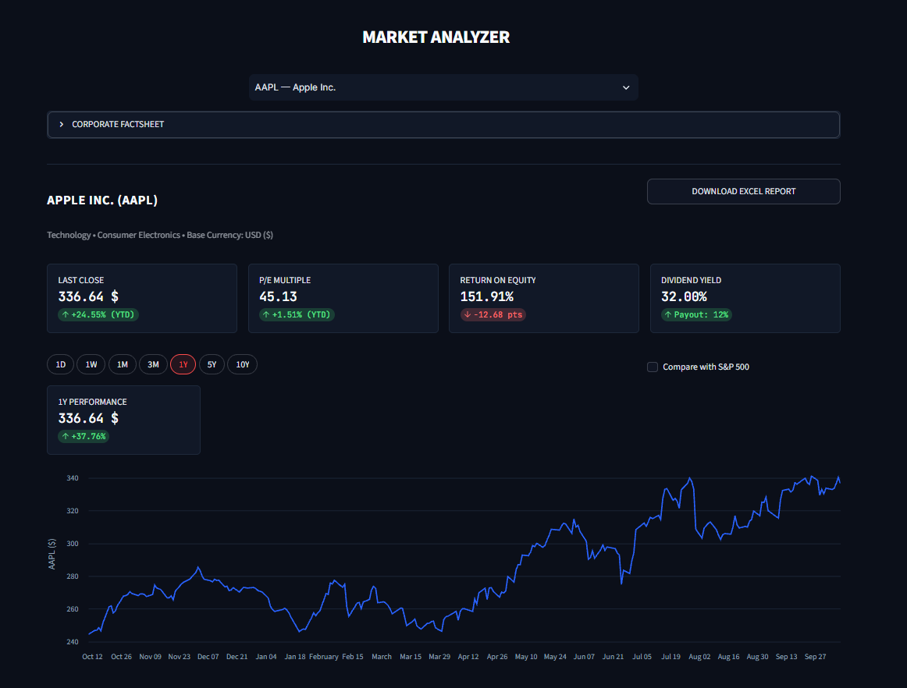
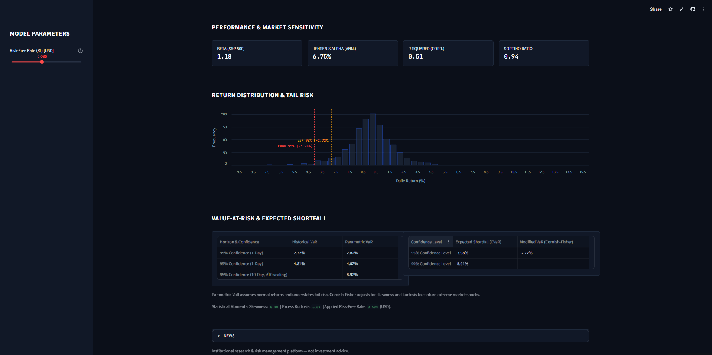

# Market Analyzer

[](https://github.com/asholani/market-analyzer/actions/workflows/tests.yml)


A Streamlit dashboard combining **fundamental analysis** and **quantitative market-risk
assessment** for stocks and commodity futures.

**Live demo:** [market-analyzer-app.streamlit.app](https://market-analyzer-app.streamlit.app/)




## Features

**Fundamental research**
- Revenue and net income over 5 fiscal years, with YoY growth and CAGR
- Piotroski F-score (up to 9 criteria)
- Leverage: debt-to-equity and interest coverage
- Valuation: current P/E vs its own 5-year average, free cash flow yield
- Analyst consensus: target price, upside, buy/hold/sell split

**Quantitative risk**
- Annualized volatility, maximum drawdown, Sharpe and Sortino ratios
- Historical, parametric and Cornish-Fisher Value-at-Risk (95% / 99%)
- Expected Shortfall (CVaR)
- CAPM beta, Jensen's alpha and R-squared against a regional benchmark
  (S&P 500, CAC 40, DAX, Nikkei 225, Hang Seng, FTSE 100, SSE Composite)

**Other**
- Searchable universe: NASDAQ-100, Dow Jones, CAC 40, DAX, Asian flagships, major commodities
- Multi-timeframe price chart with optional benchmark overlay
- Excel report export

## Methodology

All risk metrics use the last 5 years of daily closes. Returns are simple daily returns
$r_t = P_t / P_{t-1} - 1$, with $\mu$ their mean and $\sigma$ their standard deviation.
The risk-free rate $R_f$ is adjustable in the sidebar.

**Volatility (annualized)**

$$\sigma_{ann} = \sigma \sqrt{252}$$

**Historical VaR and Expected Shortfall** (confidence level $\alpha$, losses expressed as positive numbers)

$$\text{VaR}_\alpha = -Q_{1-\alpha}(r) \qquad \text{ES}_\alpha = -\mathbb{E}\left[r \mid r \le -\text{VaR}_\alpha\right]$$

**Parametric VaR** (normal returns), scaled to 10 days with the square-root-of-time rule

$$\text{VaR}_\alpha = -(\mu - z_\alpha \sigma) \qquad \text{VaR}_{10d} = \text{VaR}_{1d} \sqrt{10}$$

**Cornish-Fisher VaR**: the normal quantile is corrected for skewness $S$ and excess kurtosis $K$

$$z_{CF} = z + \frac{(z^2-1)S}{6} + \frac{(z^3-3z)K}{24} - \frac{(2z^3-5z)S^2}{36}$$

$$\text{VaR}_{CF} = -(\mu - z_{CF}\,\sigma)$$

**CAPM: beta, R-squared and Jensen's alpha** (benchmark returns $r_m$, annualized means $\bar{r}$)

$$\beta = \frac{\text{Cov}(r, r_m)}{\text{Var}(r_m)} \qquad R^2 = \text{Corr}(r, r_m)^2$$

$$\alpha = \bar{r}_{asset} - \left[R_f + \beta\left(\bar{r}_{m} - R_f\right)\right]$$

**Sharpe and Sortino ratios** (annualized, with daily risk-free rate $r_f$ and $\sigma_{down}$ the standard deviation of returns below $r_f$)

$$\text{Sharpe} = \frac{\mathbb{E}[r - r_f]}{\sigma}\sqrt{252} \qquad \text{Sortino} = \frac{\mathbb{E}[r - r_f]}{\sigma_{down}}\sqrt{252}$$

**Piotroski F-score**: sum of up to 9 binary tests (profitability, leverage/liquidity, operating efficiency), each worth 1 point when passed. Tests that lack data are skipped, so the maximum can be below 9.

### Notation

| Symbol | Meaning |
|---|---|
| $r_t$ | simple daily return of the asset |
| $\mu$, $\sigma$ | mean and standard deviation of daily returns |
| $\alpha$ (in VaR/ES) | confidence level (95% or 99%) |
| $z_\alpha$ | standard normal quantile (1.645 at 95%, 2.326 at 99%) |
| $S$, $K$ | skewness and excess kurtosis of returns |
| $r_m$ | daily return of the benchmark index |
| $R_f$, $r_f$ | annual and daily risk-free rate |
| $\sigma_{down}$ | standard deviation of returns below $r_f$ |
| $\bar{r}$ | annualized mean return (daily mean x 252) |
| VaR | loss not exceeded with probability $\alpha$ over the horizon |
| ES | average loss on days when the loss exceeds the VaR |

## Project structure

```
app.py                      Streamlit entry point
market_analyzer/
  config.py                 constants and catalogs
  data/                     Yahoo Finance, Wikipedia, Google News access
  analysis/                 pure calculation modules (no Streamlit)
    fundamentals.py         growth, dividends, leverage, Piotroski
    valuation.py            P/E context, FCF yield, analyst view
    risk.py                 volatility, VaR, CVaR, Cornish-Fisher, CAPM
  reporting/excel.py        Excel report
  ui/                       styles, Altair charts, tab rendering
  utils/formatting.py       formatting helpers
tests/                      pytest suite
```

The calculation modules take DataFrames/Series as input and never touch the network
or Streamlit, which makes them testable with synthetic data.

## Run locally

```bash
git clone https://github.com/asholani/market-analyzer.git
cd market-analyzer
pip install -r requirements.txt
python -m streamlit run app.py
```

## Tests

```bash
pip install -r requirements-dev.txt
python -m pytest
```

## Limitations

- Data comes from Yahoo Finance (via `yfinance`) and may be incomplete or delayed.
- Fundamentals are limited to what Yahoo exposes (about 4 fiscal years).
- Risk-free rates are static defaults, not live yields.
- VaR figures are statistical estimates based on past returns and do not predict future losses.

## Disclaimer

For educational purposes only. **Not investment advice.**